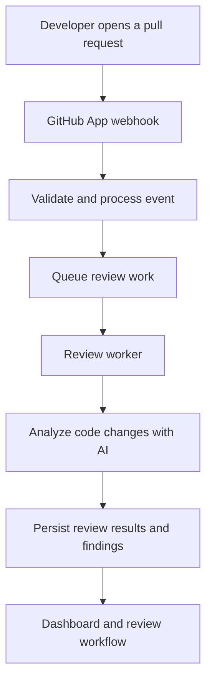

# Code Owl

### AI-powered code review, built around your pull request workflow.

**Code Owl** is an AI-powered pull request reviewer designed to help developers identify potential bugs, security concerns, and maintainability issues before they reach production.

Instead of treating code review as a one-time AI prompt, Code Owl is built around the engineering workflow: GitHub integration, asynchronous review processing, persisted review results, and a dashboard for inspecting repositories and review activity.

**[Launch Code Owl](https://owl.neeleshdev.me)** · **[View Source Code](https://github.com/Neeleshkurmi/code-owl)** · **[Documentation](#documentation)**

---

## Product Preview

<!-- Replace these paths with committed screenshots before publishing. -->

| Dashboard | Pull Request Review |
|---|---|
|  |  |
| Repository visibility and review activity | Findings and actionable review feedback |

## The Problem

Code review is one of the most valuable engineering practices and one of the easiest to turn into a bottleneck.

- **Human attention is limited.** Reviewers must balance correctness, maintainability, security, and delivery speed.
- **Issues can hide in small changes.** A narrow diff can introduce a regression that is difficult to spot without sufficient context.
- **Review feedback needs context.** A useful finding should explain the potential problem and why it matters, not merely flag a line of code.
- **Review workflows are fragmented.** Teams need visibility into repositories, pull requests, review execution, and findings.

Code Owl explores how AI-assisted analysis can make this workflow more systematic without removing human judgment from software engineering.

## What Code Owl Does

- **GitHub integration** — connects the product to GitHub repositories through a dedicated GitHub App.
- **Automated review workflow** — processes relevant pull request activity through a backend review pipeline.
- **AI-assisted analysis** — evaluates code changes for potential defects and quality concerns.
- **Structured findings** — persists review runs and findings so results can be inspected beyond a single model response.
- **Repository dashboard** — provides a foundation for understanding connected repositories and review activity.
- **Asynchronous processing** — separates incoming events from review execution so heavier work does not need to happen inside a webhook request.
- **Authentication** — supports a separate GitHub OAuth flow for dashboard sign-in.

The exact availability of individual dashboard features depends on the current deployment and implementation.

## How It Works




The architectural goal is to keep event ingestion, review execution, and result presentation as separate responsibilities.

### Why this design?

**1. Webhooks should remain lightweight**

GitHub events are an entry point, not a place to perform the entire review. Separating event handling from review execution makes the system easier to reason about and reduces coupling between incoming requests and long-running work.

**2. Reviews need durable state**

A review is more than a generated response. Persisting review runs and findings creates a basis for tracking execution, presenting results, and building future review history and analytics.

**3. Authentication and repository authorization are different concerns**

Signing into the dashboard identifies a user. Access to repositories and GitHub App installations must be handled separately, with explicit authorization checks. Code Owl uses separate GitHub Apps for user OAuth and reviewer integration.

**4. Infrastructure choices should support the workload**

The backend uses FastAPI and asynchronous database access. PostgreSQL stores application state, while the queue abstraction supports asynchronous processing. Redis is available for local queue processing, with Vercel Queue used for production deployment.

## Architecture

| Layer | Technology | Responsibility |
|---|---|---|
| API | FastAPI | HTTP endpoints, webhooks, authentication, and application operations |
| Persistence | PostgreSQL / Supabase | Users, installations, repositories, pull requests, review runs, reviews, and findings |
| ORM | SQLAlchemy | Database models and asynchronous database access |
| Schema migrations | Alembic | Versioned database schema changes |
| GitHub integration | GitHub Apps and GitHub APIs | Repository integration, event delivery, and pull request workflows |
| Background processing | Vercel Queue / Redis | Decouple event handling from review execution |
| AI analysis | LLM API integration | Analyze code changes and produce review output |
| Deployment | Vercel | Hosted application services |

## Engineering Principles

### Separate identity from installation access

OAuth is responsible for establishing the user's identity. The reviewer GitHub App is responsible for repository integration and the permissions needed to operate on repositories.

Keeping these responsibilities separate avoids treating a successful login as proof that the user can access every repository.

### Persist structured results

Review output is represented through database entities rather than being treated solely as transient text. This makes it possible to build reliable dashboard views and extend the product without redesigning the entire review flow.

### Make background work explicit

Pull request analysis can take longer than an ordinary API request. A queue-backed workflow provides a boundary between accepting an event and completing its processing.

### Evolve the schema through migrations

Database changes are managed through Alembic migrations. This keeps schema evolution explicit and reproducible across development and deployment environments.

## Technology Stack

- **Python** — backend implementation
- **FastAPI** — API layer
- **SQLAlchemy** — ORM and asynchronous database access
- **PostgreSQL / Supabase** — persistent application data
- **Alembic** — schema migrations
- **GitHub Apps** — repository integration and webhook events
- **GitHub OAuth** — user authentication
- **Redis and Vercel Queue** — background-processing infrastructure
- **LLM APIs** — AI-assisted code analysis
- **Vercel** — deployment platform

## Local Development

### Prerequisites

- Python 3.12 or later
- PostgreSQL or a configured Supabase database
- A GitHub App for reviewer integration
- A GitHub OAuth configuration for dashboard authentication
- Credentials for the configured AI provider
- Redis if using the local Redis queue backend

### 1. Clone the repository

```bash
git clone https://github.com/Neeleshkurmi/code-owl.git
cd code-owl/backend
```

### 2. Create a virtual environment

```bash
python -m venv venv
```

Activate it on Windows:

```powershell
.\venv\Scripts\Activate.ps1
```

On macOS or Linux:

```bash
source venv/bin/activate
```

### 3. Install dependencies

```bash
pip install -r requirements.txt
```

### 4. Configure environment variables

Create a local `.env` file using the repository's example configuration as a starting point. Configure the database, GitHub App credentials, OAuth credentials, JWT signing key, AI provider, queue backend, and frontend URLs.

Never commit `.env` files, private keys, access tokens, or production credentials.

### 5. Apply database migrations

```bash
alembic upgrade head
```

### 6. Start the API

```bash
uvicorn app.main:app --reload
```

The local API is available at `http://localhost:8000`.

Interactive API documentation is available at `http://localhost:8000/docs`.

> The local API setup does not by itself configure GitHub webhooks, OAuth callbacks, background workers, or the frontend. Those integrations must be configured separately.

## Configuration and Deployment

Code Owl requires environment-specific configuration for its database, GitHub integrations, authentication, AI provider, queue backend, and frontend origins.

For deployment:

1. Configure the GitHub App webhook URL and required permissions.
2. Configure the OAuth application's callback URL.
3. Set production environment variables in the deployment platform.
4. Apply database migrations before serving code that depends on the new schema.
5. Configure the production queue and its worker or consumer.
6. Verify webhook delivery, review execution, and result persistence.
7. Verify authentication and frontend-to-backend communication.

OAuth callback URLs must match the registered GitHub configuration. Local and production environments should use their own appropriate callback URLs.

## Documentation

- **Live application:** [owl.neeleshdev.me](https://owl.neeleshdev.me)
- **Source repository:** [Neeleshkurmi/code-owl](https://github.com/Neeleshkurmi/code-owl)
- **API reference:** available through the running FastAPI `/docs` endpoint
- **Architecture and design notes:** *Add resource documentation link*
- **Setup and deployment guide:** *Add setup documentation link*
- **GitHub App configuration:** *Add integration documentation link*

## Roadmap

Potential directions for future development include:

- Richer review history and repository-level insights
- Better prioritization of findings by severity and confidence
- More contextual explanations and actionable remediation guidance
- Review execution observability, retries, and failure visibility
- Expanded test coverage for webhook handling and asynchronous processing
- More detailed documentation for security, permissions, and deployment

These are potential extensions, not claims that every item is currently implemented.

## Contributing

Contributions, bug reports, and ideas are welcome. Before proposing a change, describe the problem, expected behavior, and any relevant reproduction steps.

For substantial changes, consider discussing the design before implementation so that API contracts, database migrations, and asynchronous processing remain consistent.

## License

See the [LICENSE](https://github.com/Neeleshkurmi/code-owl/blob/main/LICENSE) file for licensing details.
